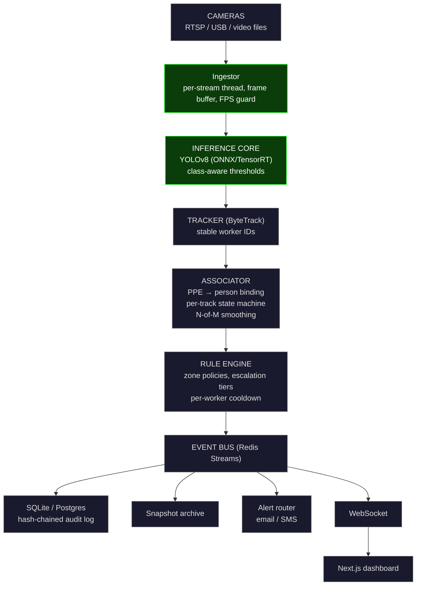

# SentinelVision

**SentinelVision is a workplace safety intelligence platform that turns commodity cameras into a
per-worker compliance system.** Unlike detection-only tools, SentinelVision binds every PPE
observation to a tracked worker, applies zone-specific policy, and produces a tamper-evident audit
log suitable for safety audits. Built on YOLOv8 with ByteTrack, ONNX Runtime, FastAPI, and a
Next.js operations dashboard.

> **Status: Phase 2 (accuracy core) complete.** Detector, class taxonomy, visualization, CLI, and the
> full pipeline: track → associate → zone policy → N-of-M vote → track-bound violation events.
> Phases 3–8 are roadmap, not built yet.

**Benchmark (TBD, Phase 8)** — SH17 val: mAP@50 = `TBD` · mAP@50:95 = `TBD` · person-attributed
violation F1 = `TBD`

📄 Method (`docs/` — Phase 8) · 📊 Benchmark (Phase 8) · 🎥 Demo (Phase 8) · 🚀 Live (Phase 8)

---

## Why this is not "another YOLO PPE detector"

```
frame → YOLO → draw box → done        # what everyone else ships
```

The model is ~20% of this. The other 80% is association, rules and operations — and the failure
modes that come with skipping them:

| Failure mode | Why it happens | What SentinelVision does | Phase |
|---|---|---|---|
| Single-frame false positives | One blurry frame flags a violation | N-of-M temporal voting per track | 2 |
| Violation with no owner | `no-hardhat` detected, but *which* worker? | Person attribution via IoU + track ID | 2 |
| One-size-fits-all rules | Welding bay ≠ loading dock | Zone policies with per-zone PPE requirements | 3 |
| Alert fatigue | 200 alerts/shift, all ignored | Per-worker cooldown + severity tiers | 3–4 |
| No audit trail | "Prove it happened" | Hash-chained event log | 4 |
| Demo-only | Runs on laptop, dies on Jetson | ONNX/TensorRT export + Docker | 7 |

**Phase 1 delivers the foundation those layers stand on.** In particular it fixes the two things
that quietly poison every later phase: a class taxonomy that survives real dataset spellings, and
BGR-correct rendering.

---

## Architecture (target system; Phase 1 covers the shaded path)



Everything downstream of the model is what makes it a *platform*.

---

## Phases 1–2 — what is actually in this repo

```
sentinelvision/
├── pyproject.toml              # uv/pip-installable, ruff + pytest config
├── src/sentinelvision/
│   ├── __init__.py
│   ├── __main__.py             # python -m sentinelvision
│   ├── config.py               # 10-class taxonomy + class-aware thresholds
│   ├── classes.py              # normalize_class_name / is_violation / is_compliant
│   ├── detector.py             # YOLO wrapper, runtime names, per-class filtering
│   ├── visualize.py            # BGR-correct, top-edge-safe labels
│   ├── cli.py                  # argparse entry point
│   └── logging_setup.py        # structlog
├── tests/
│   ├── fakes.py                # fake ultralytics surface (no torch, no weights)
│   ├── test_classes.py
│   ├── test_detector.py
│   ├── test_visualize.py
│   └── test_cli.py
│   ├── tracking.py             # [2] Box geometry, IoU, track-ID plumbing
│   ├── association.py          # [2] person↔PPE binding, 3-state slots
│   ├── worker.py               # [2] WorkerState + WorkerRegistry
│   ├── voting.py               # [2] N-of-M temporal voting + hysteresis
│   ├── events.py               # [2] ViolationEvent, content-addressed IDs, EventBus
│   └── pipeline.py             # [2] FramePipeline + Policy seam
├── tests/
│   ├── fakes.py                # fake ultralytics surface (no torch, no weights)
│   └── test_*.py               # 167 tests, all weight-free
├── benchmarks/evaluate_video.py # [8] FP-rate measurement (numbers TBD)
├── scripts/detect_webcam.py    # thin wrapper
├── docs/architecture.md        # Mermaid sequence diagram
├── setup.ps1                   # Windows bootstrap
└── README.md
```

### The class taxonomy

```python
CLASS_THRESHOLDS = {
    "person":          0.35,
    "Hardhat":         0.50,
    "NO-Hardhat":      0.65,   # violations punished harder
    "Safety Vest":     0.50,
    "NO-Safety Vest":  0.65,   # note the space
    "Mask":            0.50,
    "NO-Mask":         0.65,
    "Safety Cone":     0.55,
    "machinery":       0.55,
    "vehicle":         0.55,
}
```

A missed worker is cheap. A false violation erodes trust. Hence the split: recall-tolerant
thresholds for people, precision-strict thresholds for violation classes.

### Two foundations, deliberately hardened

**1. Name normalization.** The dataset emits `NO-Safety Vest` — uppercase prefix, space inside the
name — while `Safety Vest` is a *compliant* class. Any naive `startswith("NO")` / `split` logic
breaks on that space and silently upgrades a violation to compliance (or vice versa).

```python
normalize_class_name("NO-Safety Vest")  # -> "no-safety-vest"
normalize_class_name("no_safety_vest")  # -> "no-safety-vest"
normalize_class_name("  NO  Safety Vest  ")  # -> "no-safety-vest"
```

The violation set is **derived from the taxonomy**, never hard-coded:

```python
VIOLATION_CLASSES = tuple(sorted(s for s in NORMALIZED_CLASSES if s.startswith("no-")))
```

So a future `NO-Gloves` is caught automatically instead of being silently ignored.

**2. BGR correctness.** OpenCV is BGR, not RGB. The palette is defined once as explicit BGR tuples
and asserted channel-by-channel in the tests:

```python
GREEN_BGR = (0, 255, 0)   # green-dominant: index 1 is 255
RED_BGR   = (0, 0, 255)   # red-dominant:   index 2 is 255
```

Labels for boxes that hug the top edge flip *below* the box (`y1 < 30`), so a worker at the top of
frame still gets a readable label instead of one clipped off-screen.

---

## Quickstart

```bash
# dev install (tests + lint only -- no torch, no weights, no camera)
pip install -e ".[dev]"
pytest
ruff check .

# with the vision runtime
pip install -e ".[dev,vision]"
python -m sentinelvision --list-classes
python -m sentinelvision --source 0 --show          # webcam preview
python -m sentinelvision --source clip.mp4 --save out.mp4 --max-frames 500
```

Windows: `./setup.ps1` (add `-Vision` to install ultralytics).

### `--list-classes`

```
person          0.35
Hardhat         0.50
NO-Hardhat      0.65
Safety Vest     0.50
NO-Safety Vest  0.65
Mask            0.50
NO-Mask         0.65
Safety Cone     0.55
machinery       0.55
vehicle         0.55

10 classes, 3 violations: no-hardhat, no-mask, no-safety-vest
```

---

## Design decisions

| Layer | Choice | Why not the obvious pick |
|---|---|---|
| Inference | ONNX Runtime primary, TensorRT optional | Not `ultralytics.predict()` in production |
| Tracker | ByteTrack (Phase 2) | SORT degrades badly on occlusion |
| Backend | FastAPI + Pydantic v2 + async (Phase 5) | Flask is dead; this is what hiring managers read |
| Realtime | WebSocket + Redis Streams (Phase 4–5) | Event-driven, not polling |
| DB | SQLite → Postgres+TimescaleDB (Phase 4) | Single-site → multi-site migration path |
| Frontend | Next.js 14 App Router + shadcn/ui + Recharts (Phase 5) | Streamlit doesn't ship |
| Config | Pydantic Settings | Not raw dicts; env-overridable via `SENTINEL_*` |
| Testing | pytest + pytest-cov + hypothesis | Property-based tests for the rule engine |
| CI | GitHub Actions: lint + test + ONNX export smoke test | Green checkmarks matter |
| Packaging | `uv` (falls back to pip cleanly) | 10× faster, modern |

Phase 1 is testable with **zero** heavy dependencies: `ultralytics` is imported lazily inside
`Detector.load()`, and the tests inject a fake model exposing the same `names` / `predict()` surface.

---

## Roadmap

| Phase | Deliverable | Time | Prestige signal |
|---|---|---|---|
| **1 ✅** | Tested Detector, taxonomy, CLI, BGR-correct viz | 1 day | Clean tests, no bugs |
| **2 ✅** | ByteTrack IDs, person attribution, N-of-M voting, `ViolationEvent` | 3 days | **The accuracy jump** |
| 3 | Zone engine (polygon geofences + per-zone PPE policy) | 2 days | Nobody else does this |
| 4 | Hash-chained audit log, SQLite, snapshot archive | 2 days | "Compliance-grade" |
| 5 | FastAPI + WebSocket dashboard | 3 days | The demo people screenshot |
| 6 | Auto-generated shift reports (PDF) + analytics | 2 days | The "sell to management" piece |
| 7 | ONNX/TensorRT export + Docker Compose + Jetson profile | 2 days | Deployable, not demo-ware |
| 8 | Benchmark on SH17 / Pictor-v3, publish numbers, open weights | 3 days | Citable, portfolio-grade |

**Prestige signals to engineer (not wait for):** Mermaid architecture diagram versioned in-repo ✓ ·
public-dataset benchmark table · 60-second real-webcam demo GIF · HF Spaces live URL ·
reproducible `train.py` + dataset YAML + Dockerfile · short method/ablation writeup in `docs/` ·
open weights on HF Hub · real coverage badge · honest ablation vs baseline YOLOv8n PPE detector.

## License

Apache-2.0 (commercial-friendly, signals intent).
