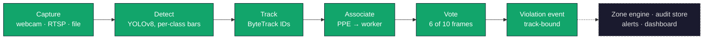

<div align="center">

<a href="https://sentinelvision-sonubiswal.netlify.app">
  
</a>

<br/>
<br/>

# SentinelVision

### Detect permissively. Commit conservatively.

PPE compliance that answers the question every safety manager actually asks:<br/>
**which worker, which rule, and can you prove it?**

<br/>

[](https://sentinelvision-sonubiswal.netlify.app)
[](https://github.com/sonubiswal/sentinelvision)
[](https://huggingface.co/wesleymqsss/yolov8m-construction-site-safety)


**[Live site](https://sentinelvision-sonubiswal.netlify.app)** ·
**[Quick start](#quick-start)** ·
**[How it works](#how-it-works)** ·
**[Roadmap](#roadmap)** ·
**[Links](#links)**

</div>

<br/>

SentinelVision binds every PPE observation to a **tracked worker**, applies the policy you configure,
and writes a **tamper-evident audit trail**. It runs on commodity cameras and a CPU, with no cloud dependency.

> [!NOTE]
> **Status: Phase 2 (accuracy core) complete.** Detector, class taxonomy, visualization, CLI and the
> full pipeline: track → associate → N-of-M vote → track-bound violation events.
> Phases 3–8 are roadmap, not built yet.

---

## At a glance

<table>
<tr>
<td align="center" width="25%"><h3>6 of 10</h3>frames must agree<br/>before an event is raised</td>
<td align="center" width="25%"><h3>SHA-256</h3>hash-chained<br/>audit log</td>
<td align="center" width="25%"><h3>289</h3>weight-free tests<br/>at 96% coverage</td>
<td align="center" width="25%"><h3>CPU only</h3>no GPU, no cloud,<br/>no camera needed to test</td>
</tr>
</table>

**Benchmark (Phase 8):** SH17 val mAP@50 = `TBD` · mAP@50:95 = `TBD` · person-attributed violation F1 = `TBD`

---

## Why SentinelVision

```
frame → YOLO → draw box → done        # what everyone else ships
```

The model is about 20% of the work. The other 80% is association, rules and operations, and the
failure modes that come with skipping them.

| Failure mode | Why it happens | What SentinelVision does | Phase |
|---|---|---|:---:|
| Single-frame false positives | One blurry frame flags a violation | N-of-M temporal voting per track | 2 (done) |
| Violation with no owner | `NO-Hardhat` detected, but *which* worker? | Person attribution via IoU / containment + track ID | 2 (done) |
| One-size-fits-all rules | A welding bay is not a loading dock | Zone policies with per-zone PPE requirements | 3 |
| Alert fatigue | 200 alerts a shift, all ignored | Per-worker cooldown and severity tiers | 3–4 |
| No audit trail | "Prove it happened" | Hash-chained event log in SQLite / Postgres | 4 |
| Demo-only | Runs on a laptop, dies on a Jetson | ONNX / TensorRT export and Docker | 7 |

### Core capabilities

| | |
|---|---|
| **Per-worker attribution** | Every `NO-Hardhat` is bound to a tracked person, never a floating box. |
| **Temporal voting** | A violation must appear in 6 of the last 10 frames. One bad frame can never raise an event. |
| **Tamper-evident audit trail** | Edit one character and the chain breaks. |
| **Class-aware thresholds** | Recall-tolerant for people, precision-strict for violations. |
| **Runs anywhere** | Commodity cameras, CPU only, zero cloud dependency. |
| **Weight-free tests** | No torch, no weights, no camera required. |

---

## Quick start

```bash
pip install -e ".[dev,vision]"
pip install gradio
python app.py            # opens http://127.0.0.1:7860
```

The demo app has four tabs:

| Tab | What it shows |
|---|---|
| **Image** | Detect, bind PPE to each worker, judge against your policy, annotate. |
| **Video · temporal vote** | The same pipeline over footage, with a 6-of-10 quorum before a violation is committed. |
| **Audit trail** | A SHA-256 hash-chained `events.jsonl`. Edit any character, press **Verify chain**, and watch it break. |
| **Policy & classes** | The ten-class taxonomy with per-class confidence bars. |

> Set `SV_MODEL=path/to/weights.pt` to use weights other than `models/ppe.pt`.

Prefer to explore first? The landing page is live at
[sentinelvision-sonubiswal.netlify.app](https://sentinelvision-sonubiswal.netlify.app).

---

## How it works



Detection is deliberately permissive. Commitment is deliberately conservative: nothing becomes an
event until the pipeline is sure it is looking at a person and not a flicker.

| Step | Stage | What happens |
|:---:|---|---|
| 1 | **Detect** | YOLOv8 finds persons and PPE items. Each class is gated by its own confidence bar. |
| 2 | **Track** | ByteTrack gives each person a stable ID, so findings belong to a worker rather than a pixel box. |
| 3 | **Associate** | PPE binds to its worker by geometric containment, falling back to IoU. Overlaps are resolved deterministically (containment, then overlap share, then the smaller person box). |
| 4 | **Vote** | A violation must appear in at least 6 of the last 10 frames. One bad frame can never raise an event. |
| 5 | **Audit** | Committed events carry a SHA-256 digest over their contents and the previous digest. |

<details>
<summary><b>Example event</b></summary>

<br/>

```json
{
  "ts": "2026-10-13T09:41:07.221Z",
  "camera": "cam-04",
  "zone": "gate-b",
  "track_id": 17,
  "findings": [
    { "class": "Hardhat", "conf": 0.90, "verdict": "present" },
    { "class": "NO-Safety Vest", "conf": 0.81, "verdict": "violation", "votes": 6, "window": 10 }
  ],
  "policy": "gate-b: hardhat+safety-vest required",
  "prev_sha256": "b71e…",
  "sha256": "9f3c…a41d"
}
```

</details>

> [!TIP]
> The demo app already includes a hash-chained JSONL log so you can see the idea working.
> The production audit store (SQLite, snapshot archive, retention) lands in Phase 4.

---

## Design principles

**Evidence scales with consequence.** A missed worker is cheap. A false violation erodes trust.
Recall-tolerant bars apply to people, precision-strict bars to violation classes, and the 6-of-10
quorum sits on top, so raising an alarm always demands more evidence than recording compliance.

```python
CLASS_THRESHOLDS = {
    "person":          0.35,
    "Hardhat":         0.50,
    "NO-Hardhat":      0.65,   # violations need more evidence
    "Safety Vest":     0.50,
    "NO-Safety Vest":  0.65,   # note the space
    "Mask":            0.50,
    "NO-Mask":         0.65,
    "Safety Cone":     0.55,
    "machinery":       0.55,
    "vehicle":         0.55,
}
```

**Names are a safety surface.** The dataset emits `NO-Safety Vest`, with an uppercase prefix and a
space inside the name, while `Safety Vest` is a *compliant* class. Naive `startswith("NO")` or `split`
logic breaks on that space and silently turns a violation into compliance.

```python
normalize_class_name("NO-Safety Vest")        # -> "no-safety-vest"
normalize_class_name("no_safety_vest")        # -> "no-safety-vest"
normalize_class_name("  NO  Safety Vest  ")   # -> "no-safety-vest"
```

The violation set is derived from the taxonomy, never hard-coded, so a future `NO-Gloves` is caught
automatically:

```python
VIOLATION_CLASSES = tuple(sorted(s for s in NORMALIZED_CLASSES if s.startswith("no-")))
```

**Colors are a correctness bug waiting to happen.** OpenCV is BGR, not RGB. The palette is defined
once as explicit BGR tuples and asserted channel by channel in the tests.

```python
GREEN_BGR = (0, 255, 0)   # green-dominant: index 1 is 255
RED_BGR   = (0, 0, 255)   # red-dominant:   index 2 is 255
```

Labels for boxes that hug the top edge flip *below* the box (`y1 < 30`), so a worker at the top of
the frame still gets a readable label.

---

## Command line

```bash
# dev install (tests + lint only: no torch, no weights, no camera)
pip install -e ".[dev]"
pytest
ruff check .

# with the vision runtime
pip install -e ".[dev,vision]"
python -m sentinelvision --list-classes
python -m sentinelvision --model models/ppe.pt --source 0 --show            # webcam preview
python -m sentinelvision --model models/ppe.pt --source clip.mp4 \
    --events-jsonl events.jsonl --stats                                      # headless batch run
python -m sentinelvision --source clip.mp4 --save out.mp4 --max-frames 500
```

> **Windows:** run `./setup.ps1` (add `-Vision` to install ultralytics).

Events stream to the JSONL log while the run is live, and the stats block prints on exit. The log is
append-only: read the tail, never edit it.

<details>
<summary><b>Sample output of <code>--list-classes</code></b></summary>

<br/>

```
$ python -m sentinelvision --list-classes
person          0.35
Hardhat         0.50
NO-Hardhat      0.65
Safety Vest     0.50
NO-Safety Vest  0.65
Mask            0.50
NO-Mask         0.65
Safety Cone     0.55
machinery       0.55
vehicle         0.55

10 classes, 3 violations: no-hardhat, no-mask, no-safety-vest
```

</details>

---

## Architecture

<details>
<summary><b>Repository layout</b></summary>

<br/>

```
sentinelvision/
├── app.py                      # Gradio demo (image · video vote · audit chain)
├── pyproject.toml              # uv / pip installable, ruff + pytest config
├── src/sentinelvision/
│   ├── __main__.py             # python -m sentinelvision
│   ├── cli.py                  # argparse entry point
│   ├── config.py               # 10-class taxonomy + class-aware thresholds
│   ├── classes.py              # normalize_class_name / is_violation / is_compliant
│   ├── detector.py             # YOLO wrapper, runtime names, per-class filtering
│   ├── visualize.py            # BGR-correct, top-edge-safe labels
│   ├── logging_setup.py        # structlog
│   ├── tracking.py             # [2] box geometry, IoU, track-ID plumbing
│   ├── association.py          # [2] person ↔ PPE binding, 3-state slots
│   ├── worker.py               # [2] WorkerState + WorkerRegistry
│   ├── voting.py               # [2] N-of-M temporal voting + hysteresis
│   ├── events.py               # [2] ViolationEvent, content-addressed IDs, EventBus
│   └── pipeline.py             # [2] FramePipeline + Policy seam
├── tests/
│   ├── fakes.py                # fake ultralytics surface (no torch, no weights)
│   └── test_*.py               # 289 tests, 96% coverage, all weight-free
├── benchmarks/evaluate_video.py  # [8] FP-rate measurement (numbers TBD)
├── scripts/detect_webcam.py    # thin wrapper
├── docs/architecture.md        # Mermaid sequence diagram
├── setup.ps1                   # Windows bootstrap
└── README.md
```

</details>

Everything is testable with zero heavy dependencies: `ultralytics` is imported lazily inside
`Detector.load()`, and the tests inject a fake model exposing the same `names` / `predict()` surface.

### Technology choices

| Layer | Choice | Why not the obvious pick |
|---|---|---|
| Inference | ONNX Runtime primary, TensorRT optional | Not `ultralytics.predict()` in production |
| Tracker | ByteTrack | SORT degrades badly on occlusion |
| Backend | FastAPI + Pydantic v2 + async (Phase 5) | Typed, async, easy to test |
| Realtime | WebSocket + Redis Streams (Phase 4–5) | Event-driven, not polling |
| Database | SQLite → Postgres + TimescaleDB (Phase 4) | Single-site → multi-site migration path |
| Frontend | Next.js 14 + shadcn/ui + Recharts (Phase 5) | A real dashboard, not a notebook |
| Config | Pydantic Settings | Typed and env-overridable via `SENTINEL_*` |
| Testing | pytest + pytest-cov + hypothesis | Property-based tests for the rule engine |
| CI | GitHub Actions: lint, test, ONNX export smoke test | Every change is checked |
| Packaging | `uv`, falling back to pip | Fast installs, no lock-in |

---

## Roadmap

| Phase | Deliverable | Time | Status |
|:---:|---|:---:|:---:|
| **1** | Tested detector, taxonomy, CLI, BGR-correct visualization | 1 day | Done |
| **2** | ByteTrack IDs, person attribution, N-of-M voting, `ViolationEvent` | 3 days | Done |
| **3** | Zone engine: polygon geofences + per-zone PPE policy | 2 days | Planned |
| **4** | Audit store: hash-chained SQLite log, snapshot archive | 2 days | Planned |
| **5** | FastAPI + WebSocket dashboard | 3 days | Planned |
| **6** | Auto-generated shift reports (PDF) + analytics | 2 days | Planned |
| **7** | ONNX / TensorRT export, Docker Compose, Jetson profile | 2 days | Planned |
| **8** | Benchmark on SH17 / Pictor-v3, publish numbers, open weights | 3 days | Planned |

### Remaining for a credible public release

- [ ] Benchmark table
- [ ] Hosted demo
- [ ] Reproducible `train.py` with dataset YAML and Dockerfile
- [ ] Short method and ablation write-up in `docs/`
- [ ] Open weights on the Hugging Face Hub
- [ ] Honest ablation against a baseline YOLOv8n PPE detector

---

## Links

| | |
|---|---|
| **Landing page** | [sentinelvision-sonubiswal.netlify.app](https://sentinelvision-sonubiswal.netlify.app) |
| **Source code** | [github.com/sonubiswal/sentinelvision](https://github.com/sonubiswal/sentinelvision) |
| **Model weights** | [wesleymqsss/yolov8m-construction-site-safety](https://huggingface.co/wesleymqsss/yolov8m-construction-site-safety) |
| **License** | Apache-2.0 |

---

<div align="center">

Released under the **Apache-2.0** license.

If SentinelVision is useful to you, a star on the repo helps a lot.

[Live site](https://sentinelvision-sonubiswal.netlify.app) ·
[GitHub](https://github.com/sonubiswal/sentinelvision) ·
[Weights](https://huggingface.co/wesleymqsss/yolov8m-construction-site-safety)

</div>
