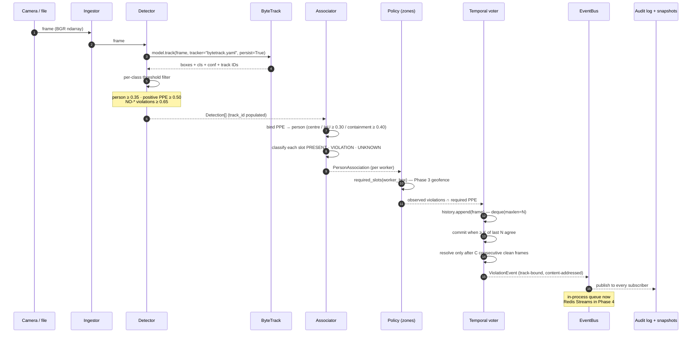
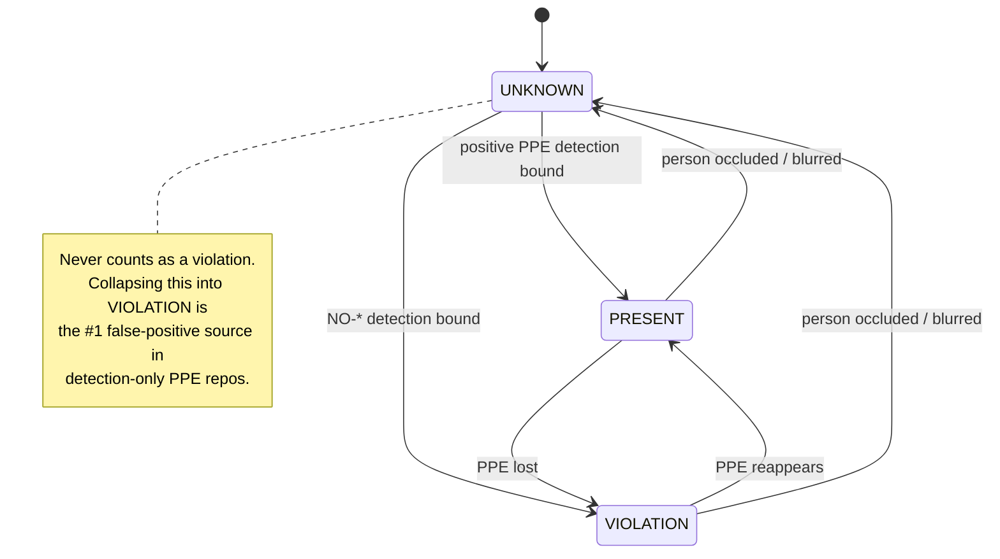
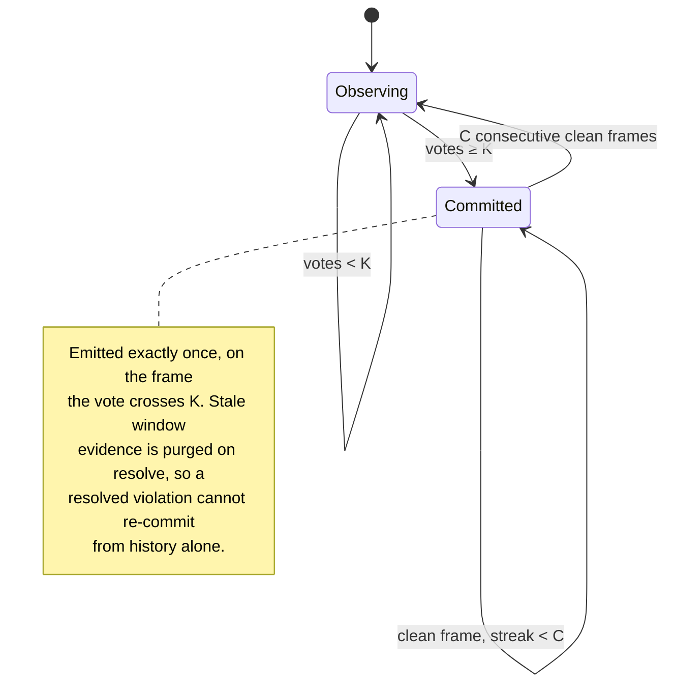
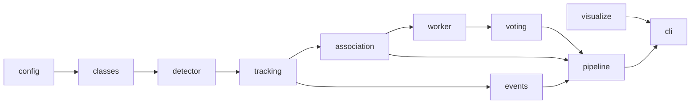

# SentinelVision — Architecture

Companion to the static component diagram in [`../README.md`](../README.md). This file
documents the **dynamic** behaviour: what actually happens, in order, to one frame and to one
violation.

## 1. One frame, end to end

## 2. Why a PPE slot has three states

## 3. Violation lifecycle (commit → resolve)

## 4. Module dependencies (no cycles)

Arrows point from dependency to dependent. `config` and `classes` sit at the bottom and import
nothing from the package; `pipeline` is the only module that knows about all the others.

## 5. Threading and back-pressure

The Phase 2 pipeline is single-threaded by design: one frame in, one `FrameResult` out. That keeps
the state machine deterministic and the tests weight-free. Concurrency arrives in Phase 4 with one
inference thread per stream, each owning its own `FramePipeline` and sharing one `EventBus`.

The bus is already safe for that: every subscriber has its own `queue.Queue`, `publish` is
non-blocking, and a full subscriber queue **drops and counts** rather than stalling inference.
Dropping a dashboard frame is survivable; stalling the detector is not.

## 6. Extension seams

| Seam | Phase 2 implementation | Later |
|---|---|---|
| `Policy` | `GlobalPolicy` (one site-wide rule) | Phase 3 polygon geofences, per-zone PPE |
| `EventBus` | in-process `queue.Queue` | Phase 4 Redis Streams |
| `Detector` backend | ultralytics `.pt` | Phase 7 ONNX Runtime / TensorRT |
| `clock` | `time.time` | injectable for deterministic replay |
| `detector` | `Detector` wrapper | any object with `names` / `detect` / `track` |
